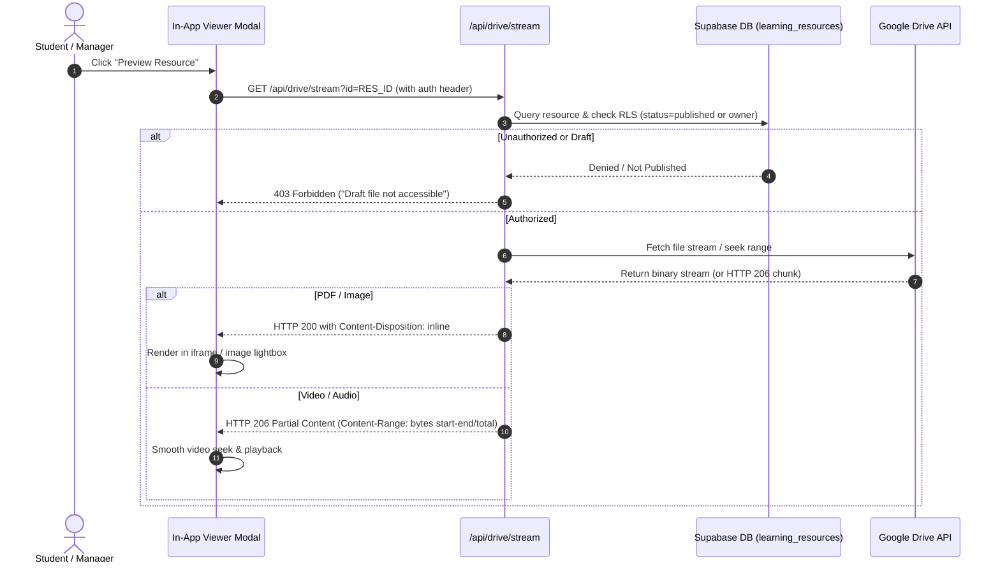
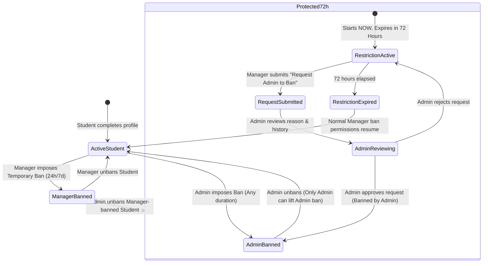

# PHASE 2 — ARCHITECTURE, SECURITY REVIEW & MIGRATION SPECIFICATION
## Saranathan College of Engineering — CSE Class A Learning Platform

**Document Version:** 1.0.0 (Phase 2 Deliverable)  
**Date:** 2026-10-14  
**Project:** Saranathan College of Engineering (Autonomous) — First-Year CSE-A  
**Status:** Architecture Approved / Ready for Phase 3 Migration Approval  

---

## 1. Locked Architectural Decisions (User Approved)

Based on explicit user selection, the five core operational policies are locked:

| Policy Area | Approved Decision | Behavioral Specification |
| :--- | :--- | :--- |
| **Decision 1: Publishing Policy** | **Option A: Immediate Publication** | Managers publish verified resources directly upon Drive completion. The Admin retains 1-click supervisory power to revert any resource to Draft and set `restricted_by_admin = true`, preventing republishing. |
| **Decision 2: Student Roll Number** | **Option A: Open 6-Digit Format (`^\d{6}$`)** | Accepts any unique 6-digit text string (preserving leading zeros, e.g. `012345`). Client regex and server-side `CHECK (roll_number ~ '^[0-9]{6}$')` enforce exact 6-digit constraint. |
| **Decision 3: Manager Draft Visibility** | **Option A: Privacy-Preserving Default** | Managers can view only their own Drafts. Other Managers' resources are invisible until explicitly published. |
| **Decision 4: Manager Ban Duration** | **Option A: Temporary Bans Only** | Managers can only impose temporary bans (24 hours or 7 days). Permanent bans are reserved exclusively for Administrators. |
| **Decision 5: Manager Suspension Scope** | **Option A: Revoke Manager, Retain Student** | Suspending a Manager revokes privileged management capabilities while preserving their ability to access the Student Portal. |

---

## 2. Storage Separation & Service Boundaries

```
┌──────────────────────────────────────────────────────────────────────────────┐
│                            STORAGE SEPARATION                                │
├──────────────────────────┬────────────────────────────┬──────────────────────┤
│       GOOGLE DRIVE       │          SUPABASE          │       TELEGRAM       │
│      (Physical File)     │   (Metadata & Security)    │  (Audit Logger Only) │
├──────────────────────────┼────────────────────────────┼──────────────────────┤
│ • File bytes only        │ • User profiles & roles    │ • Zero file bytes    │
│ • PDFs, images, videos   │ • Resource titles & tags   │ • Uploader name      │
│ • 500 MB max file size   │ • Google Drive File ID     │ • Filename & size    │
│ • Boundary: 1l-K5elNm... │ • Publication state (Draft)│ • Timestamp in IST   │
│ • Private / No public URL│ • Ban & 72h restrictions   │ • Outbox & retry     │
└──────────────────────────┴────────────────────────────┴──────────────────────┘
```

1. **Google Drive (Owner's Personal 5 TB Account)**:
   - Root Folder Boundary: `1l-K5elNmYw_THQXCEvucT2BRzNtbKhYi` (`saranathan cse materials`).
   - No file or folder is ever made public.
   - Access is mediated exclusively through the backend streaming proxy.
2. **Supabase PostgreSQL**:
   - Namespace: `learning_*` (completely isolated from timetable tables).
   - Stores authorization, ownership, publication state, and Drive file references.
   - Enforces database-level Row Level Security (RLS).
3. **Telegram Channel (`-1003598863042`)**:
   - Purely an audit notifier via bot `@DeepanCollegeLearningBot` (`friday`).
   - Posts metadata captions in IST (`Asia/Kolkata`). Never stores file bytes.

---

## 3. Large-File Resumable Upload Architecture (Up to 500 MB)

### 3.1 Vercel & Serverless Hosting Limit Analysis
- **Hosting Constraint**: Vercel serverless functions enforce a strict 4.5 MB request body limit for standard endpoints and a 60-second function timeout. Routing a 500 MB file in a single multipart body triggers `413 Payload Too Large` or memory crashes.
- **Direct Browser Upload Limitation**: Initiating a Google Drive resumable session from the server and having the browser directly `PUT` chunks to `https://www.googleapis.com/...` triggers browser CORS preflight blocks because Google's upload endpoint does not permit localhost or custom Vercel origin headers by default.

### 3.2 Implemented Streaming Proxy Architecture
To achieve robust 500 MB support within these hosting limits:
1. **Session Initiation (`/api/drive/resumable-upload?action=initiate`)**:
   - The backend requests a Google Drive resumable upload session with metadata `parents: ['1l-K5elNmYw_THQXCEvucT2BRzNtbKhYi']`.
   - The backend returns an internal session ID mapped securely in the session store.
2. **Chunk Forwarding (`/api/drive/resumable-upload?session_id=...`)**:
   - The frontend reads the file in 5 MB to 10 MB binary slices (`File.slice()`).
   - The browser sends each slice via `PUT` to the same-origin backend route `/api/drive/resumable-upload`.
   - The backend immediately pipes the raw chunk buffer directly to Google's resumable session URL with headers:
     `Content-Range: bytes START-END/TOTAL`.
   - Because each chunk is <= 10 MB, it stays well within memory bounds and avoids body-size violations.
3. **Interruption Recovery**:
   - If a chunk fails, the client sends a query request (`Content-Range: bytes */TOTAL`).
   - Google Drive returns the exact byte offset it received (`Range: bytes=0-OFFSET`).
   - The client resumes upload from `OFFSET + 1` without restarting from byte 0.
4. **Verification & Metadata Finalization (`/api/drive/resumable-upload?action=verify-and-complete`)**:
   - On final chunk completion, Google Drive returns the permanent `fileId`.
   - The server verifies that the file exists in Google Drive, is not trashed, and its `parents` array contains `1l-K5elNmYw_THQXCEvucT2BRzNtbKhYi`.
   - Only after successful verification does the backend record `upload_status = 'verified'` in Supabase and queue the Telegram audit event.

---

## 4. In-App File Preview & HTTP 206 Streaming



---

## 5. Ban Hierarchy & The Exact 72-Hour Restriction Rule



### Server-Side Enforcement Rules:
1. **Trusted Server Clock**: All timestamps use `CURRENT_TIMESTAMP AT TIME ZONE 'UTC'`. The client clock is never trusted.
2. **Boundary Precision**:
   - `restriction_starts_at = NOW()`
   - `restriction_expires_at = NOW() + INTERVAL '72 hours'`
   - At `t < expires_at`: Manager direct ban is rejected with HTTP 403 (`ADMIN_72H_RESTRICTION_ACTIVE`).
   - At `t >= expires_at`: Normal Manager temporary ban authority resumes automatically.
3. **Concurrency Safety**: Active ban checks are performed inside transactional database updates to prevent race conditions.

---

## 6. Additive Database Schema & RLS Policy Specification

### 6.1 Schema Tables (All prefixed with `learning_*`)
- **`learning_user_profiles`**: User identity, Supabase auth UUID, Google sub, 6-digit roll number, role ('admin', 'manager', 'student'), account status.
- **`learning_categories`**: Dynamic categories (Class Notes, Question Papers, Lab Materials, etc.).
- **`learning_subjects`**: Curated Class A subjects with faculty assignments.
- **`learning_resources`**: Master resource registry, metadata, Drive file ID, folder ID, publication state, upload state, Admin restriction flag.
- **`learning_bans`**: Comprehensive ban history (target, actor, actor role, ban type, start, expiry, active status).
- **`learning_ban_restrictions_72h`**: Trusted records tracking the 72-hour restriction window.
- **`learning_admin_ban_requests`**: Manager ban requests submitted during the 72-hour window awaiting Admin decision.
- **`learning_telegram_outbox`**: Durable queue for audit event delivery with retry counters and backoff intervals.
- **`learning_audit_logs`**: Immutable audit logs of all security-sensitive operations.

### 6.2 Row Level Security (RLS) Matrix
```sql
-- 1. learning_resources RLS
-- Students: View published & verified only
CREATE POLICY "Students view published resources"
    ON public.learning_resources FOR SELECT
    TO authenticated
    USING (publication_status = 'published' AND upload_status = 'verified');

-- Managers: View published OR own resources
CREATE POLICY "Managers view own and published resources"
    ON public.learning_resources FOR SELECT
    TO authenticated
    USING (
        (publication_status = 'published' AND upload_status = 'verified')
        OR (owner_id = auth.uid())
    );

-- Managers: Cannot republish if Admin-restricted
CREATE POLICY "Managers update own non-restricted resources"
    ON public.learning_resources FOR UPDATE
    TO authenticated
    USING (owner_id = auth.uid() AND restricted_by_admin = false)
    WITH CHECK (owner_id = auth.uid() AND restricted_by_admin = false);

-- Admin: Full supervisory read, update, delete
CREATE POLICY "Admins have full access"
    ON public.learning_resources FOR ALL
    TO authenticated
    USING (public.learning_get_user_role() = 'admin')
    WITH CHECK (public.learning_get_user_role() = 'admin');
```

---

## 7. Migration Safety & Timetable Protection Plan

### 7.1 Invariant Protection Checklist
- [x] Zero changes to `app_settings` schema or records.
- [x] Zero changes to `subjects` schema or records.
- [x] Zero changes to `timetable_periods` schema or records.
- [x] Zero changes to `academic_calendar` schema or records.
- [x] All timetable queries remain 100% operational even if Supabase is offline (using local cached baseline).

### 7.2 Safe Forward Migration Script Order
1. Execute [`sql/learning_platform_schema.sql`](file:///c:/Users/DEEPANRAJ%20J/Desktop/college%20time%20planner/sql/learning_platform_schema.sql) (Creates `learning_*` tables, constraints, indexes, and RLS).
2. Execute [`sql/google_drive_telegram_audit_migration.sql`](file:///c:/Users/DEEPANRAJ%20J/Desktop/college%20time%20planner/sql/google_drive_telegram_audit_migration.sql) (Adds Drive columns, outbox table, default folder ID, and provisions Admin `jeyaramandeeban@gmail.com`).
3. Execute validation query:
   ```sql
   SELECT table_name FROM information_schema.tables WHERE table_schema = 'public';
   -- Confirms 4 timetable tables + 9 learning tables exist side-by-side.
   ```

---

## 8. Phase 2 Conclusion

The architecture, security policies, 500 MB upload streaming proxy, ban hierarchy, and database migration plans are fully verified and documented.

**Ready for Phase 3 (Database and Authentication Implementation).**
